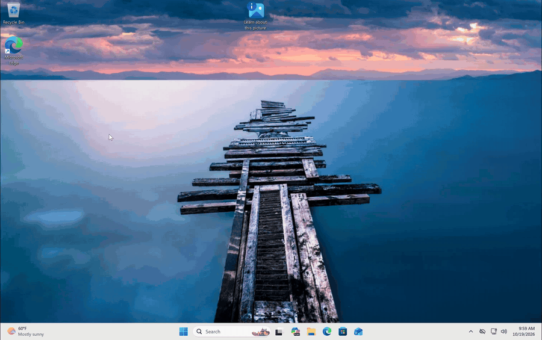
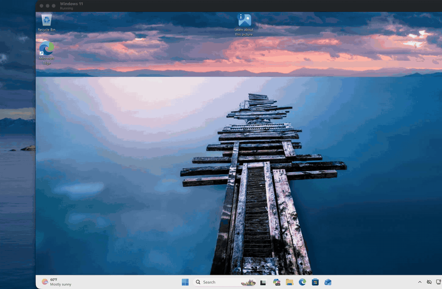
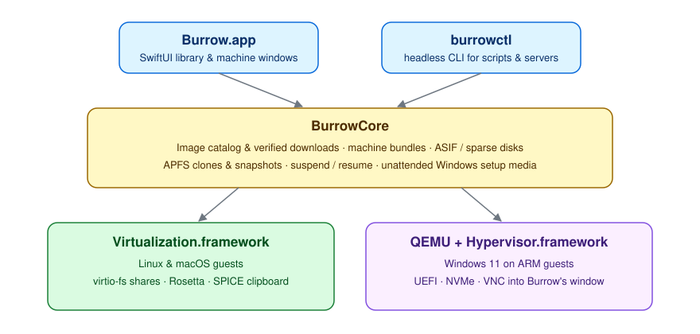

<div align="center">


# Burrow

### Free, open-source virtual machines for Apple silicon Macs.

**Run Linux, Windows 11 and macOS on your Mac in one click. No ISO hunting, no license fees.**

[](https://github.com/DaniilPak/burrow/actions/workflows/ci.yml)
[](LICENSE)
[](#requirements)
[](Package.swift)
[](CONTRIBUTING.md)
[](https://github.com/DaniilPak/burrow/stargazers)

[Quick start](#quick-start) · [Features](#features) · [How it works](#how-burrow-works) · [Command line](#command-line) · [FAQ](#faq) · [Contributing](#contributing)

</div>

<p align="center">
  <br>
  <sub>Windows 11 on ARM running in Burrow (1.5× speed)</sub>
</p>

## Contents

- [Quick start](#quick-start)
- [Features](#features)
- [How Burrow works](#how-burrow-works)
- [Command line](#command-line)
- [FAQ](#faq)
- [Project layout](#project-layout)
- [Contributing](#contributing)
- [License](#license)

---

Want Ubuntu, Windows 11 or a fresh copy of macOS on your Mac? Open Burrow, click **+**,
pick a system and click **Download & Create**. Burrow fetches the installer from the
publisher, checks it, builds the machine and starts setup. That's it.

Burrow is a native SwiftUI app built on Apple's Virtualization.framework, plus
`burrowctl`, a command-line tool for running the same machines headless in scripts
and on servers. Everything runs locally, and the code is MIT licensed.

> [!NOTE]
> Burrow is an original implementation. Parallels Desktop was studied only at the
> architecture level (which components exist and which system frameworks they use);
> no code was copied or translated.

## Quick start

### Requirements

- Apple silicon Mac (M1 or newer) on macOS 14 Sonoma or later
- Xcode with Swift 6 to build from source
- For Windows 11 guests: QEMU (`brew install qemu`)

### Build and run

```bash
git clone https://github.com/DaniilPak/burrow.git
cd burrow
./scripts/build-app.sh          # → build/Burrow.app and build/burrowctl
open build/Burrow.app
```

Click **+**, pick Linux, Windows or macOS, and click **Download & Create** (or
**Continue…** for Windows). Progress shows in the sidebar, and the machine starts its
installer when the download is done.

Binaries are ad-hoc signed with the `com.apple.security.virtualization` entitlement.
Set `SIGN_IDENTITY` to sign with a Developer ID instead.

## Features

<p align="center">
  <br>
  <sub>Fedora booting to the desktop (5× speed)</sub>
</p>

| | |
|---|---|
| **No ISO hunting** | The latest Ubuntu, Fedora, Debian and Alpine come straight from each publisher, checked against the published SHA-256. Images are cached for reuse. |
| **Windows 11 on ARM** | Pick a language on Microsoft's own download page and click Download; Burrow fetches the drivers, creates the machine and runs Setup unattended. |
| **macOS guests** | Downloads the newest macOS your Mac supports (or uses a local IPSW) and installs it, with progress in the sidebar. |
| **Suspend & resume** | Saves memory and device state to disk and continues exactly where you left off. |
| **Instant clones & snapshots** | APFS copy-on-write: no waiting, and no extra space until the guest writes new data. |
| **Sparse disks** | Apple Sparse Image Format (ASIF) with a raw sparse fallback; disks can grow later. |
| **Integration** | Shared folders (virtio-fs), clipboard sharing (SPICE agent), Rosetta for x86-64 Linux binaries, sound, optional microphone, NAT networking. |
| **`burrowctl`** | Create, configure, clone, snapshot and run machines headless from the terminal. |
| **Safe by default** | A running machine is locked against changes by other processes, and deleting moves it to the Trash. |

## How Burrow works

<p align="center">
  
</p>

- **Linux and macOS guests** run directly on Virtualization.framework, booting
  through UEFI (Linux) or Apple's macOS installer.
- **Windows 11 on ARM guests** run under QEMU with Hypervisor.framework acceleration,
  since Windows' boot manager hangs under Virtualization.framework. The screen,
  keyboard and mouse stay in Burrow's window (VNC over a private socket), on UEFI
  firmware with an NVMe disk that Windows supports out of the box.
- For Windows, Burrow generates a setup disc with an `autounattend.xml` that skips
  Setup's TPM and Secure Boot checks and allows a local account without a network.
  It installs the virtio-win ARM64 drivers (networking and others) at first sign-in.
  Burrow presses the "boot from CD" key for you, and the installer is only attached
  while the disk is still empty.

Each machine is a `<name>.burrow` folder: `machine.json`, the disk, firmware state
(`efi-variables.fd` or `auxiliary-storage.img`), identity files, an optional
`suspended.vzvmsave`, `snapshots/`, and `console.log` (Linux serial output).
Machines live in `~/Library/Application Support/Burrow/Machines` (override with
`BURROW_HOME`).

### Inside a Linux guest

```bash
sudo mount -t virtiofs burrow /mnt/burrow       # shared folders
sudo mount -t virtiofs rosetta /mnt/rosetta     # Rosetta (then register it with binfmt_misc)
sudo apt install spice-vdagent                  # clipboard sharing
```

## Command line

```bash
burrowctl images                                # what Burrow can download
burrowctl create-linux "Ubuntu" --distro ubuntu-desktop --cpus 4 --memory 8 --disk 64
burrowctl share "Ubuntu" code ~/Projects --read-only
burrowctl snapshot "Ubuntu" fresh install
burrowctl clone "Ubuntu" "Ubuntu Test"
burrowctl create-windows "Windows 11" --iso ~/Downloads/Win11_ARM64.iso   # drivers download automatically
burrowctl run "Ubuntu Test"                     # headless; Ctrl-C suspends
burrowctl help
```

`Burrow -BurrowAutostart "<name>"` opens and starts a machine at launch.

## FAQ

**Can I run x64 (Intel) Windows or Linux?**
No. Virtualization.framework runs ARM64 guests only. Linux guests can run x86-64
binaries through Rosetta.

**What doesn't work in Windows guests yet?**
There is no virtual TPM (BitLocker and Windows Hello PIN-backed keys are unavailable),
and Windows gets a basic framebuffer display without 3D acceleration or dynamic
resizing. Sound and clipboard sharing need drivers Windows on ARM doesn't have.
Shared folders need virtio-win's viofs driver plus WinFsp. These are good places to
[contribute](CONTRIBUTING.md).

**Is there USB passthrough?**
Not yet.

**Where is my data?**
In `~/Library/Application Support/Burrow/Machines`, one `.burrow` folder per machine.
Nothing leaves your Mac except the installer downloads.

## Project layout

| Path | Purpose |
|---|---|
| `Sources/BurrowCore` | Engine: machine bundles, VM configuration, disks, snapshots, macOS installer, running sessions |
| `Sources/Burrow` | SwiftUI app |
| `Sources/burrowctl` | CLI |
| `Tests/BurrowCoreTests` | Unit tests (`swift test`) |
| `scripts/` | App bundle and icon build scripts |

## Contributing

Bug reports, fixes, docs and new guest support are all welcome. Start with
[CONTRIBUTING.md](CONTRIBUTING.md), or pick an issue labeled
[`good first issue`](https://github.com/DaniilPak/burrow/labels/good%20first%20issue).

If Burrow saves you a Parallels license, a ⭐ helps other people find it.

## Star history

[](https://star-history.com/#DaniilPak/burrow&Date)

## License

[MIT](LICENSE) © Daniil Pak
